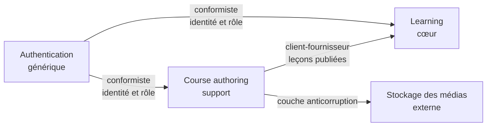
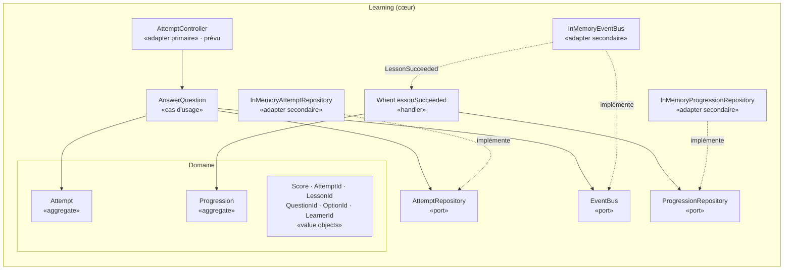
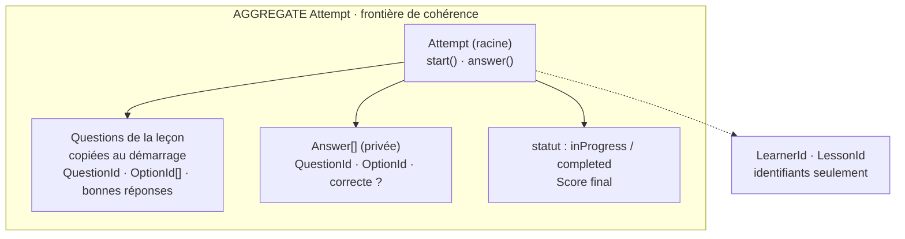
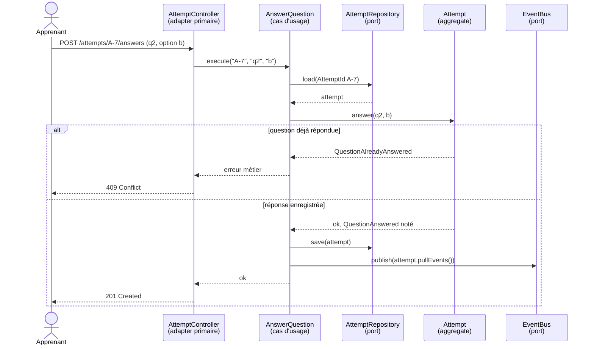
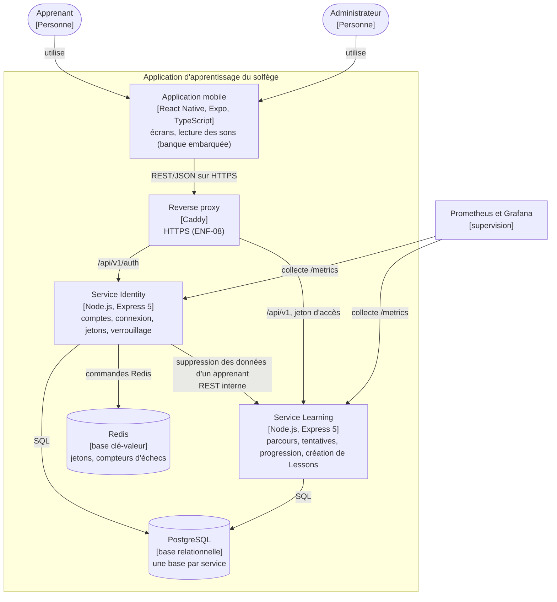

# Document d'architecture : application d'apprentissage du solfège et de l'oreille musicale

## 1. Contexte et objectifs

L'application aide un apprenant (élève, autodidacte, curieux) à progresser en solfège et en oreille musicale par des leçons courtes, sur le modèle de Duolingo. Un administrateur compose et publie les leçons. L'apprenant les démarre, répond aux questions une par une et progresse de niveau en niveau.

Dans le MVP, deux surfaces partagent le même modèle (ADR-004) :
- une **application mobile** Android, pour l'entraînement quotidien ;
- l'**API HTTP**, répartie en deux services, Identity et Learning (ADR-005).

Un site web pourra s'ajouter plus tard comme nouvel adaptateur primaire de la même API ; il est hors du MVP.

**Objectifs d'architecture**

| Objectif | Moyen |
|---|---|
| Une règle métier s'applique de la même façon sur le site et sur le mobile | Les règles vivent dans le domaine, pas dans les contrôleurs ni dans les clients |
| Tester les règles sans base de données | Architecture hexagonale : le cœur ne dépend que de ports (interfaces), les tests utilisent des adapters en mémoire |
| Pouvoir changer de base de données | Seuls les adapters de repository connaissent la base |
| Rendre les états interdits impossibles | Aggregates et value objects qui valident tout à la construction |
| Les bonnes réponses ne quittent jamais le serveur | La correction se fait dans l'aggregate, côté serveur |

## 2. Modélisation stratégique

Le détail (mur d'event storming, glossaire complet, sous-domaines) se trouve dans [`strategique.md`](strategique.md). Résumé :

**Contextes**

| Contexte | Type | Choix |
|---|---|---|
| **Learning** (Apprentissage) | Cœur | DDD complet, objet de ce document |
| **Course authoring** (Création de cours) | Support | Modèle simple, validations testées |
| **Authentication** (Authentification) | Générique | Construite en interne, service Identity (ADR-005, ADR-006) |
| Stockage des médias | Générique | Service externe, plus un adapter ; les séquences musicales n'en font plus partie (ADR-009) |

**Langage commun : le métier et le code**

| Métier | En code | Définition |
|---|---|---|
| Tentative | `Attempt` | Un passage d'un apprenant sur une leçon, de son démarrage à sa fin |
| Cours, leçon | `Lesson` | ⚠ En Création : un contenu qu'on compose, brouillon puis publié. En Apprentissage : une leçon qu'on démarre, puis qu'on réussit ou échoue |
| Apprenant | `Learner` | ⚠ En Authentification : un compte avec un rôle. En Apprentissage : une personne qui progresse |
| Question | `Question` | Un énoncé et ses options |
| Option | `Option` | Une réponse proposée (au moins 2 par question) |
| Bonne réponse | `correctOptions` | Les options attendues (au moins 1) |
| Réponse | `Answer` | L'option choisie par l'apprenant, correcte ou non |
| Score | `Score` | Pourcentage de réponses correctes, de 0 à 100 |
| Seuil de réussite | `PASSING_THRESHOLD` | 75 %, le même pour toutes les leçons |
| Niveau requis | `requiredLevel` | Niveau minimum pour démarrer une leçon |
| Progression | `Progression` | Les leçons réussies d'un apprenant ; son niveau est leur nombre |

**Carte des contextes**



## 3. Architecture hexagonale

### Diagramme de composants



*Flèche pleine : « utilise ». Pointillés : « implémente », ou transport d'un événement. Les flèches pleines pointent vers le cœur : le domaine n'importe rien de l'application ni de l'infrastructure.*

### Arborescence

```
src/
├── learning/
│   ├── domain/            Attempt, Progression, Score, ids, errors, events
│   ├── application/       AnswerQuestion, WhenLessonSucceeded
│   │   └── ports/         AttemptRepository, ProgressionRepository
│   └── infrastructure/    adapters en mémoire (puis base de données)
└── shared/                DomainEvent, EventBus, InMemoryEventBus
tests/
└── learning/              tests du domaine et du cas d'usage, sans base
```

### Ports et adapters

| Port (interface du cœur) | Rôle | Adapter aujourd'hui | Adapter prévu |
|---|---|---|---|
| `AttemptRepository` | Charger et enregistrer une tentative **entière** | `InMemoryAttemptRepository` | Adapter base de données |
| `ProgressionRepository` | Charger et enregistrer la progression d'un apprenant | `InMemoryProgressionRepository` | Adapter base de données |
| `EventBus` | Publier les événements du domaine | `InMemoryEventBus` | Inchangé au départ |

Un repository par **aggregate**, pas un par table : on ne peut pas ajouter une réponse sans passer par `Attempt`.

## 4. Modèle du contexte cœur : l'aggregate `Attempt`

### Contenu



`Attempt` garde l'apprenant et la leçon **par identifiant**, jamais l'objet entier. La liste des réponses est `private` : la seule façon de la modifier est `answer()`.

### Value objects

| Value object | Règle |
|---|---|
| `Score` | Entier de 0 à 100, sinon `InvalidScoreError`. `isSuccessful()` vaut vrai si le score est ≥ 75. `fromAnswers(correct, total)` arrondit à l'inférieur |
| `AttemptId` | `new()` génère un UUID ; `from()` reconstruit et refuse une chaîne vide |
| `LessonId`, `QuestionId`, `OptionId`, `LearnerId` | `from()` refuse une chaîne vide. Valeur `private` : TypeScript refuse de confondre deux identifiants |

### Règles de création (factory `Attempt.start()`)

| Règle | Erreur métier |
|---|---|
| La leçon doit être publiée | `LessonNotPublished` |
| Niveau de l'apprenant ≥ niveau requis | `InsufficientLevel` |
| La leçon a au moins une question | `EmptyLesson` |

### Invariants (vérifiés dans `answer()`)

| Invariant | Erreur métier |
|---|---|
| On ne répond plus à une tentative terminée | `AttemptAlreadyCompleted` |
| La question appartient à la leçon | `QuestionNotInLesson` |
| Une question ne reçoit qu'une seule réponse | `QuestionAlreadyAnswered` |
| L'option appartient à la question | `OptionNotInQuestion` |

Chaque invariant a son test dans `tests/learning/domain/Attempt.test.ts`. Le test vérifie que l'opération est refusée **et** que l'état n'a pas changé.

**Règle automatique** : dès que toutes les questions ont une réponse, la tentative se termine d'elle-même, calcule son `Score` et annonce le résultat. Un score sous 75 % n'est pas une erreur, c'est un résultat (`LessonFailed`).

### Domain events

| Événement | Produit par | Écouté par |
|---|---|---|
| `LessonStarted` | `Attempt.start()` | — |
| `QuestionAnswered` | `Attempt.answer()`, à chaque réponse | — |
| `LessonSucceeded` | Fin automatique, score ≥ 75 % | `WhenLessonSucceeded`, qui met à jour la `Progression` |
| `LessonFailed` | Fin automatique, score < 75 % | — |

L'aggregate **note** ses événements ; le cas d'usage les retire avec `pullEvents()` et les publie après l'enregistrement.

### Le second aggregate : `Progression`

Il porte l'histoire de l'apprenant sur plusieurs tentatives : les leçons réussies et le niveau (leur nombre). `recordSuccess(lessonId)` ignore une leçon déjà réussie : pas de régression, et recevoir deux fois le même événement ne fait pas monter le niveau deux fois.

## 5. Séquence d'un cas d'usage : « l'apprenant répond à une question »



**Erreurs métier et codes HTTP** (traduction faite par le contrôleur, jamais par le domaine)

| Erreur | HTTP | Raison |
|---|---|---|
| `QuestionAlreadyAnswered`, `AttemptAlreadyCompleted` | 409 Conflict | Conflit avec l'état actuel de la tentative |
| `QuestionNotInLesson`, `OptionNotInQuestion`, `InvalidID` | 422 Unprocessable Entity | Requête bien formée mais incohérente |
| `InsufficientLevel` | 403 Forbidden | L'apprenant n'a pas le droit de démarrer cette leçon |
| `LessonNotPublished` | 404 Not Found | Une leçon non publiée n'existe pas pour l'apprenant |

## 6. Décisions

Chaque ADR consigne une décision d'architecture et sa justification, comme le prévoit la norme ISO/IEC/IEEE 42010 (description d'architecture). À partir de l'ADR-004, les critères de décision reprennent les caractéristiques de qualité de la norme ISO/IEC 25010.

### ADR-001 · Deux aggregates reliés par un événement

Statut : acceptée (2026-10-22)

**Contexte**
Réussir une leçon change deux choses : l'état de la tentative et le niveau de l'apprenant. Le niveau dépend de toutes les tentatives passées, la tentative ne connaît qu'elle-même.

**Décision**
`Attempt` et `Progression` sont deux aggregates distincts. `Attempt` publie `LessonSucceeded` ; le handler `WhenLessonSucceeded` met à jour la `Progression` dans une seconde transaction.

**Alternative écartée**
Un seul aggregate « Apprenant » contenant ses tentatives et son niveau : un aggregate géant, chargé en entier à chaque réponse, alors que l'invariant « une seule réponse par question » ne concerne que la tentative.

**Conséquences**
+ Une transaction par aggregate ; `Attempt` ne connaît pas `Progression`.
+ Le niveau se teste séparément.
− Cohérence à terme : le niveau monte un instant après la réussite.
− Le handler doit être idempotent : `recordSuccess()` ignore une leçon déjà réussie.

### ADR-002 · Copier les questions et les bonnes réponses dans la tentative au démarrage

Statut : acceptée (2026-10-22)

**Contexte**
Pour corriger chaque réponse, `Attempt` doit connaître les options et les bonnes réponses. Ces données appartiennent à la leçon, qui vient du contexte Création.

**Décision**
`Attempt.start()` reçoit la leçon et copie ses questions, options et bonnes réponses dans la tentative.

**Alternative écartée**
Relire la leçon à chaque réponse : la tentative dépendrait d'un autre aggregate, et une leçon modifiée en cours de route changerait la correction d'une tentative déjà commencée.

**Conséquences**
+ `answer()` corrige sans aucune dépendance externe : testable en mémoire.
+ Une tentative commencée n'est pas affectée par une modification de la leçon (point chaud du mur).
− Les données de la leçon sont dupliquées dans chaque tentative.

### ADR-003 · Arrondi du score à l'inférieur

Statut : acceptée (2026-10-22)

**Contexte**
Le score se calcule en pourcentage de bonnes réponses ; certains résultats ne tombent pas juste (2 sur 3 = 66,67 %). Le seuil de réussite est 75 %.

**Décision**
`Score.fromAnswers()` arrondit à l'inférieur.

**Alternative écartée**
L'arrondi au plus proche : 74,6 % deviendrait 75 % et l'apprenant réussirait grâce à l'arrondi.

**Conséquences**
+ On ne réussit jamais grâce à un arrondi.
− Un score affiché peut sembler sévère d'un point.

### ADR-004 · Surfaces du MVP : une appli Android en React Native avec Expo, et l'API

Statut : acceptée (2026-11-26)

**Contexte**
Le §1 de ce document, écrit le 22/10, prévoyait trois surfaces : un site web rendu côté serveur, une application mobile et l'API. La note de cadrage v3 (30/10) exclut la version web du MVP et retient une application mobile en React Native, Android au minimum (objectif d'apprentissage A1). L'application doit être accessible (ENF-01 à ENF-04 : TalkBack, cibles de 48 dp, taille de texte du système) et jouer du son avec une faible latence (ENF-12).

**Décision**
Le MVP comporte deux surfaces : une application Android écrite en React Native avec Expo, en TypeScript, et l'API REST. Le site web sort du MVP. L'application est construite avec un build de développement Expo, et non avec Expo Go, pour pouvoir intégrer des modules natifs, en particulier pour l'audio.

**Critères (ISO/IEC 25010)**
Portabilité (une base de code, Android d'abord, iOS possible ensuite), maintenabilité (TypeScript partagé avec l'API), utilisabilité et accessibilité (composants natifs exposés à TalkBack), efficacité de performance (audio).

**Alternatives écartées**
- Une application web progressive (PWA) : pas de build natif, mais un accès moins fiable à l'audio à faible latence et à l'accessibilité native d'Android ; le cadrage demande une application mobile.
- Flutter : performant, mais un second langage (Dart) et aucun partage de types avec l'API.
- React Native sans Expo : plus de contrôle, mais toute la configuration native (Gradle, signature, modules) est à faire à la main, pour un projet de 35 h.

**Conséquences**
+ TypeScript de bout en bout ; les contrats de l'API se partagent avec l'application (ADR-007).
+ Les composants React Native exposent les propriétés d'accessibilité lues par TalkBack et suivent la taille de texte du système par défaut.
+ Un site web pourra s'ajouter plus tard comme nouvel adaptateur primaire de la même API.
− Un build de développement est nécessaire dès qu'un module natif entre dans le projet : Expo Go ne suffit plus.
− Pas de version web pour les démonstrations : il faut un téléphone ou un émulateur Android.

### ADR-005 · Deux microservices : Identity et Learning

Statut : acceptée (2026-11-26)

**Contexte**
Le syllabus impose un backend en microservices, exposé en API REST ; le cadrage en limite le nombre à deux pour tenir les 35 h. La modélisation stratégique distingue trois contextes : Learning (cœur), Course authoring (support, fournisseur de Learning) et Authentication (générique). L'authentification est construite en interne (ADR-006).

**Décision**
Deux services, chacun propriétaire de sa base :
- **Identity** : comptes, connexion, jetons, verrouillage, préférences du compte (dont le mode sobre) ;
- **Learning** : le contexte Learning et le contexte Course authoring, en deux modules séparés du même service.

Learning vérifie lui-même les jetons d'accès avec la clé publique d'Identity, sans l'appeler à chaque requête. Aucun service ne lit la base de l'autre. Un seul échange direct entre eux : à la suppression d'un compte (ENF-11), Identity appelle d'abord un point d'entrée interne de Learning, qui efface les tentatives et la progression de l'apprenant, puis supprime le compte.

**Critères (ISO/IEC 25010)**
Maintenabilité (modularité : un service par frontière de contexte), sécurité (les données d'authentification sont isolées), fiabilité (Learning sert un apprenant déjà connecté même si Identity est indisponible).

**Alternatives écartées**
- Trois services, avec Course authoring à part : la publication d'une Lesson devrait traverser le réseau vers Learning, avec une synchronisation à gérer, pour un contexte aux règles simples ; et la limite du cadrage serait dépassée.
- Un monolithe modulaire : plus simple, mais contraire au syllabus.
- Un bus de messages pour la suppression de compte : plus découplé, mais une brique d'infrastructure de plus pour un seul échange.

**Conséquences**
+ La frontière entre les deux services suit une frontière de contexte : ils échangent très peu.
+ Course authoring reste un module à part dans Learning : on pourra l'extraire en service si ses règles grossissent.
− Si l'appel d'Identity à Learning échoue, la suppression du compte est refusée et doit être relancée : aucune donnée orpheline, au prix d'une suppression parfois à refaire.
− Deux services à déployer, superviser et tester.
− Learning fait confiance au rôle porté par le jeton pour ouvrir les fonctions de création de Lessons.

### ADR-006 · Authentification construite en interne

Statut : acceptée (2026-11-26)

**Contexte**
La modélisation stratégique classait l'authentification en sous-domaine générique « qu'on achète ». La spécification du MVP fixe pourtant des exigences précises : mots de passe hachés (ENF-07), verrouillage après 5 échecs en 15 minutes (ENF-10), effacement complet des données personnelles (ENF-11), données minimales et aucun traceur (ENF-09). Les comptes administrateurs sont créés hors de l'application (RG-14).

**Décision**
Le service Identity gère lui-même l'authentification :
- mots de passe hachés avec **Argon2id**, au minimum aux paramètres recommandés par l'OWASP (19 Mio de mémoire, 2 itérations, parallélisme de 1) ;
- jeton d'accès **JWT signé en EdDSA**, valable 15 minutes, portant l'identifiant et le rôle ;
- jeton de rafraîchissement opaque et aléatoire, valable 30 jours, conservé dans Redis sous forme hachée (SHA-256) et remplacé à chaque usage ;
- sur le téléphone, les jetons sont rangés dans le stockage sécurisé du système (Keystore d'Android) ;
- verrouillage : un compteur d'échecs par compte dans Redis, qui expire au bout de 15 minutes ; au cinquième échec, le compte est bloqué pour 15 minutes ;
- le même message d'erreur, que le compte existe ou non ;
- les comptes administrateurs sont créés par un script en ligne de commande du service.

**Critères (ISO/IEC 25010)**
Sécurité (confidentialité, intégrité, authenticité), conformité au RGPD, maintenabilité (des exigences vérifiables par des tests).

**Alternatives écartées**
- Un fournisseur d'identité hébergé (Auth0, Supabase Auth…) : moins de code, mais ENF-07 et ENF-10 deviendraient « déléguées au fournisseur », un sous-traitant traiterait des données personnelles, et la suppression d'un compte demanderait un appel de plus.
- Un serveur d'identité à installer (Keycloak) : complet, mais une brique lourde à exploiter pour deux rôles.
- bcrypt : éprouvé, mais limité aux 72 premiers octets du mot de passe ; Argon2id est conçu pour consommer de la mémoire, ce qui freine les attaques par carte graphique.
- Des sessions côté serveur, vérifiées à chaque requête : révocation immédiate, mais Learning devrait interroger Identity à chaque appel (ADR-005).

**Conséquences**
+ ENF-07, ENF-09, ENF-10 et ENF-11 sont tenues telles qu'écrites, et testables.
+ Learning vérifie les jetons seul, avec la clé publique.
− Un jeton d'accès reste valable jusqu'à 15 minutes après une déconnexion ou une suppression de compte.
− Le verrouillage par compte permet à un tiers qui connaît une adresse e-mail de bloquer ce compte pendant 15 minutes : compromis accepté.
− La sécurité de l'authentification est sous notre responsabilité : garde de la clé de signature, mises à jour des dépendances.
− Remplace, sur ce point, le §2 de ce document et la modélisation stratégique (« on achète »).

### ADR-007 · Monorepo avec les workspaces npm

Statut : acceptée (2026-11-26)

**Contexte**
Le projet comprend une application mobile et deux services, tous en TypeScript (ADR-004, ADR-005). L'application et les services partagent les contrats de l'API : la forme des requêtes et des réponses. Le domaine Learning vit aujourd'hui à la racine du dépôt (`src/learning`). Les règles de correction ne doivent jamais être embarquées dans l'application : les bonnes réponses ne quittent pas le serveur (§1).

**Décision**
Un seul dépôt, organisé en workspaces npm :

```
apps/mobile/           application React Native (Expo)
services/identity/     service Identity
services/learning/     service Learning (src/learning et tests/learning y migrent)
packages/contracts/    types des requêtes et réponses de l'API, sans logique
```

L'application ne dépend que de `packages/contracts`. Le domaine Learning n'est pas un paquet partagé : il reste à l'intérieur de son service.

**Critères (ISO/IEC 25010)**
Maintenabilité (un changement de contrat se fait en un seul commit, des deux côtés), compatibilité (un contrat typé, partagé), sécurité (le domaine n'est pas importable par l'application).

**Alternatives écartées**
- Un dépôt par application et par service : les contrats seraient des paquets à publier et à versionner, avec trois intégrations continues et des modifications éclatées sur plusieurs dépôts.
- pnpm, ou un outil de monorepo (Nx, Turborepo) : plus rapides, mais les liens symboliques de pnpm posent des difficultés connues au bundler de React Native, et un outil de plus n'apporte rien à cette taille de projet.

**Conséquences**
+ Une seule intégration continue, qui teste l'ensemble à chaque modification.
+ Le compilateur signale toute rupture de contrat entre l'application et un service.
− Le dépôt existant est à réorganiser : `src/learning` et `tests/learning` partent dans `services/learning`.
− Metro, le bundler de React Native, doit fonctionner avec les workspaces ; les versions récentes d'Expo le configurent elles-mêmes, à vérifier au premier sprint.

### ADR-008 · API REST avec Express 5

Statut : acceptée (2026-11-26)

**Contexte**
Le syllabus impose une API REST. Le §5 de ce document décrit déjà les échanges en REST (`POST /attempts/{id}/answers`) et la traduction des erreurs métier en codes HTTP. En architecture hexagonale, le framework web n'est qu'un adaptateur primaire. Le projet cumule déjà plusieurs nouveautés pour moi (hexagonal, DDD, React Native, audio) ; je connais Express.

**Décision**
Chaque service expose une API REST/JSON avec Express 5, cantonné à l'infrastructure (`infrastructure/http`) : il reçoit la requête, valide sa forme, appelle un cas d'usage, puis traduit la réponse ou l'erreur. Les routes sont préfixées par `/api/v1`. La validation se fait à deux niveaux :
- la forme (champs présents, types) à l'entrée, avec des schémas Zod ;
- les règles métier (RG-06, RG-07…) dans le domaine, qui reste la seule source de vérité.

**Critères (ISO/IEC 25010)**
Maintenabilité (le framework se remplace sans toucher au cœur), fiabilité (Express 5 transmet au gestionnaire d'erreurs les erreurs des fonctions asynchrones), maîtrise du risque sur 35 h.

**Alternatives écartées**
- NestJS : structure et injection de dépendances intégrées, mais il impose sa propre organisation en modules, qui brouille la frontière hexagonale que le projet doit rendre visible ; et il s'apprend.
- Fastify : plus rapide, validation intégrée, mais un outil de plus à apprendre sans besoin de performance identifié.
- GraphQL : souple pour le client, mais hors du cadre imposé, et plus complexe à sécuriser et à mettre en cache.

**Conséquences**
+ Le cœur ne connaît pas Express : changer de framework ne touche que l'adaptateur.
+ Les schémas Zod peuvent produire les types de `packages/contracts`.
− Aucune structure imposée : l'organisation repose sur les conventions du projet, à vérifier par un test d'architecture.
− Deux niveaux de validation : veiller à ne pas recopier les règles métier dans les schémas.

### ADR-009 · Format JSON des séquences musicales

Statut : acceptée (2026-11-26)

**Contexte**
Une question d'ear training porte une séquence de notes à faire entendre (RG-07). Le cadrage retenait le MIDI comme format source ; la modélisation stratégique prévoyait de stocker les fichiers MIDI dans un service de médias externe. Le contenu doit rester léger, modifiable par l'administrateur depuis l'application, et servir au son puis, plus tard, à l'affichage d'une partition. Le chapitre 2 travaille les intervalles : deux notes jouées l'une après l'autre (intervalle mélodique) ou ensemble (intervalle harmonique).

**Décision**
Une séquence est un objet JSON stocké avec la question :

```json
{
  "tempo": 60,
  "notes": [
    { "pitch": 60, "start": 0, "duration": 1 },
    { "pitch": 67, "start": 1, "duration": 1 }
  ]
}
```

- `pitch` : numéro de note MIDI (60 = do central) ;
- `start` et `duration` : en temps, au tempo indiqué ; deux notes de même `start` sonnent ensemble ;
- règles de validité, vérifiées dans le domaine : au moins une note, des durées positives, des hauteurs comprises dans l'étendue de la banque de sons (ADR-010).

**Critères (ISO/IEC 25010)**
Maintenabilité (lisible, testable, versionné avec les questions), efficacité (quelques dizaines d'octets par question, ENF-06), portabilité (convertible en fichier MIDI standard ou en partition).

**Alternatives écartées**
- Des fichiers MIDI (.mid) : format standard, mais binaire, stocké à part (service de médias), illisible dans une revue de code et plus difficile à valider.
- Une notation texte (« C4 G4 ») : compacte, mais un analyseur à écrire et à maintenir, et elle exprime mal les durées et la simultanéité.

**Conséquences**
+ Plus de service de médias pour l'audio : les séquences voyagent avec les questions.
+ Une seule source pour le son et, plus tard, pour la partition.
− Format maison : sa documentation et ses règles de validité sont à notre charge.
− Afficher une partition demandera des informations absentes aujourd'hui (armure, mesure) : le format évoluera, avec un numéro de version si besoin.

### ADR-010 · Son produit à partir d'une banque d'échantillons embarquée

Statut : proposée (2026-11-26), à confirmer par le prototype audio du premier sprint

**Contexte**
Le son doit démarrer moins de 200 ms après l'action « Écouter » (cible d'ENF-12), sans téléchargement de fichier audio lourd (ENF-06). Le cadrage identifiait le synthétiseur MIDI tiers comme un risque (latence, écarts entre plateformes). Les intervalles harmoniques exigent de jouer deux notes exactement en même temps (ADR-009).

**Décision**
L'application joue les séquences à partir d'une petite banque d'échantillons de piano, intégrée à l'application :
- un échantillon par demi-ton, de do 3 à do 6 (37 notes, numéros MIDI 48 à 84), sans transposition ;
- des fichiers mono et courts (environ 1,5 s), au format OGG Vorbis, lu nativement par Android ; budget total : moins de 1 Mo ;
- une banque sous licence libre (CC0 ou CC-BY), dont la source et la licence sont citées dans le dépôt ;
- une bibliothèque qui programme les sons sur l'horloge audio, pour démarrer deux notes au même instant ; candidate : `react-native-audio-api`, qui reproduit la Web Audio API ;
- en mode sobre (ENF-05), rien n'est préchargé : les échantillons d'une question sont chargés au premier « Écouter ».

**Critères (ISO/IEC 25010)**
Efficacité de performance (latence), utilisabilité (un timbre réaliste pour un public de musiciens), maintenabilité (aucun module natif à écrire), sobriété (poids embarqué borné).

**Alternatives écartées**
- La synthèse par oscillateurs : aucun fichier, mais un timbre de sinusoïde peu musical.
- Un module natif (synthétiseur MIDI d'Android, FluidSynth) : aucun échantillon à gérer, mais du code Kotlin et un pont vers React Native à écrire et à maintenir, pour une latence incertaine.
- Une SoundFont générale (General MIDI) : tous les instruments, mais des dizaines de mégaoctets.

**Conséquences**
+ Aucune transposition à la lecture : le timbre reste fidèle sur toute l'étendue.
+ ENF-06 est reformulée : le son n'est plus « synthétisé », il est produit sur l'appareil à partir d'échantillons embarqués.
− L'étendue est limitée à trois octaves : une séquence qui en sort est refusée à la création (ADR-009).
− En mode sobre, le premier son d'une question peut dépasser la cible de latence : à mesurer au prototype.
− Le prototype peut remettre en cause la bibliothèque candidate ; le principe de la banque embarquée, lui, est acquis.

### ADR-011 · Persistance : PostgreSQL et Redis

Statut : acceptée (2026-11-26)

**Contexte**
Le syllabus impose une base multi-paradigmes (relationnelle et NoSQL). Chaque service est propriétaire de ses données (ADR-005). Les données du MVP n'ont pas les mêmes besoins : les règles de cohérence (e-mail unique, une Lesson dans un seul chapitre, tentatives conservées) appellent des contraintes et des transactions ; les données d'authentification à courte durée de vie appellent une expiration automatique.

**Décision**

| Donnée | Service | Base | Pourquoi | Ce que ça coûte |
|---|---|---|---|---|
| Comptes : e-mail, pseudo, mot de passe haché, rôle, préférences (mode sobre) | Identity | PostgreSQL | Unicité de l'e-mail garantie par une contrainte (RG-01) ; transactions | — |
| Jetons de rafraîchissement | Identity | Redis | Expiration native ; révocation par suppression de la clé | Perdus si Redis redémarre sans persistance : persistance AOF activée |
| Compteurs d'échecs de connexion | Identity | Redis | Incrément atomique, expiration au bout de 15 minutes (ENF-10) | Un redémarrage remet les compteurs à zéro : acceptable |
| Chapitres et Lessons | Learning | PostgreSQL, questions en JSONB | Ordre des chapitres et appartenance des Lessons en relationnel (RG-02 à RG-04) ; contenu des questions, de forme variable selon la modalité et porteur des séquences (ADR-009), en document JSONB | La forme du JSON est vérifiée par le domaine, pas par la base |
| Tentatives et réponses | Learning | PostgreSQL, questions copiées en JSONB | L'aggregate `Attempt` est enregistré en entier (ADR-002) ; historique conservé (RG-10) ; une transaction par aggregate (ADR-001) | Questions dupliquées dans chaque tentative |
| Progression | Learning | PostgreSQL | Aggregate `Progression`, lu à chaque ouverture du parcours | — |

Une seule instance PostgreSQL, avec une base par service ; aucun service ne lit la base de l'autre. L'outil d'accès aux données (SQL écrit à la main, query builder ou ORM) relève du modèle de données.

**Critères (ISO/IEC 25010)**
Fiabilité (intégrité, transactions), efficacité (expiration native plutôt que des purges programmées), maintenabilité (deux bases, chacune employée pour ce qu'elle fait de mieux).

**Alternatives écartées**
- MongoDB pour le contenu des Lessons : un modèle document naturel, mais une troisième base à exploiter, et l'appartenance des Lessons aux chapitres perdrait ses contraintes d'intégrité ; JSONB couvre le besoin de souplesse.
- Tout dans PostgreSQL : possible, mais l'expiration des compteurs et des jetons serait à programmer, et le syllabus impose le multi-paradigme.
- Les préférences dans Redis : rapide, mais elles doivent durer et suivre le compte (US-18).

**Conséquences**
+ Deux bases, chacune justifiée par un besoin précis : le relationnel pour l'intégrité, le clé-valeur pour l'éphémère.
+ La suppression d'un compte (ENF-11) se fait par identifiant dans chaque base.
− Deux technologies à installer, sauvegarder et superviser (Docker Compose, exporteurs Prometheus).
− Learning n'utilise pas Redis : le multi-paradigme repose sur le service Identity.

## 7. Vue technique du MVP (C4, niveau conteneurs)



*Chaque boîte est un conteneur au sens du modèle C4 : une application ou une base qui s'exécute séparément. Docker Compose les lance tous, en local comme sur le serveur.*
