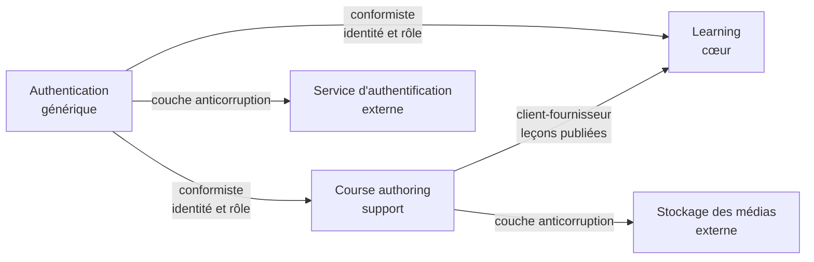
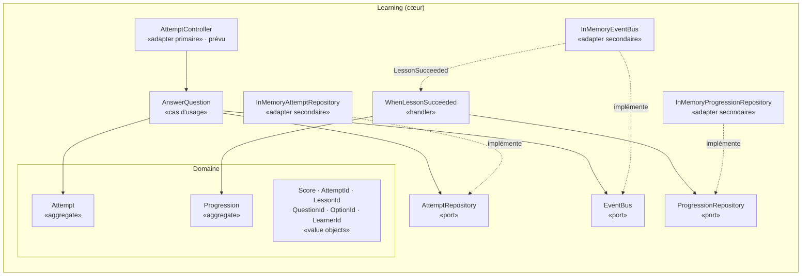
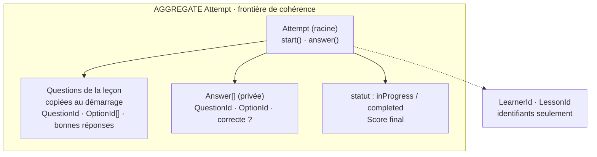
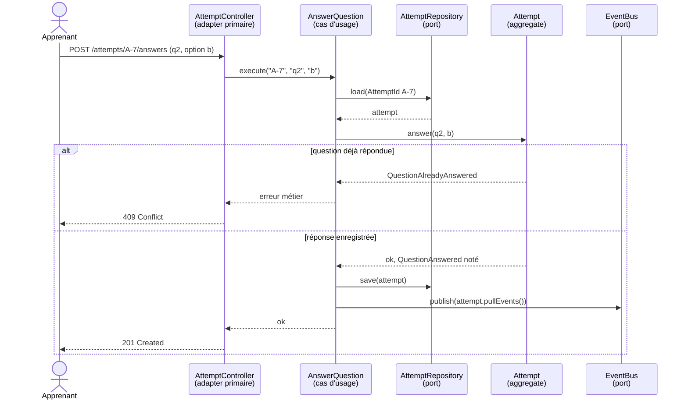

# Document d'architecture : application d'apprentissage du solfège et de l'oreille musicale

## 1. Contexte et objectifs

L'application aide un apprenant (élève, autodidacte, curieux) à progresser en solfège et en oreille musicale par des leçons courtes, sur le modèle de Duolingo. Un administrateur compose et publie les leçons. L'apprenant les démarre, répond aux questions une par une et progresse de niveau en niveau.

Trois surfaces partagent la même API, la même authentification et le même modèle :
- un **site web** rendu côté serveur ;
- une **application mobile**, pour l'entraînement quotidien ;
- l'**API HTTP** elle-même.

**Objectifs d'architecture**

| Objectif | Moyen |
|---|---|
| Une règle métier s'applique de la même façon sur le site et sur le mobile | Les règles vivent dans le domaine, pas dans les contrôleurs ni dans les clients |
| Tester les règles sans base de données | Architecture hexagonale : le cœur ne dépend que de ports (interfaces), les tests utilisent des adapters en mémoire |
| Pouvoir changer de base de données | Seuls les adapters de repository connaissent la base |
| Rendre les états interdits impossibles | Aggregates et value objects qui valident tout à la construction |
| Les bonnes réponses ne quittent jamais le serveur | La correction se fait dans l'aggregate, côté serveur |

## 2. Modélisation stratégique

Le détail (mur d'event storming, glossaire complet, sous-domaines) se trouve dans [`strategique.md`](strategique.md). Résumé :

**Contextes**

| Contexte | Type | Choix |
|---|---|---|
| **Learning** (Apprentissage) | Cœur | DDD complet, objet de ce document |
| **Course authoring** (Création de cours) | Support | Modèle simple, validations testées |
| **Authentication** (Authentification) | Générique | On achète, plus un adapter |
| Stockage des médias | Générique | Service externe, plus un adapter |

**Langage commun : le métier et le code**

| Métier | En code | Définition |
|---|---|---|
| Tentative | `Attempt` | Un passage d'un apprenant sur une leçon, de son démarrage à sa fin |
| Cours, leçon | `Lesson` | ⚠ En Création : un contenu qu'on compose, brouillon puis publié. En Apprentissage : une leçon qu'on démarre, puis qu'on réussit ou échoue |
| Apprenant | `Learner` | ⚠ En Authentification : un compte avec un rôle. En Apprentissage : une personne qui progresse |
| Question | `Question` | Un énoncé et ses options |
| Option | `Option` | Une réponse proposée (au moins 2 par question) |
| Bonne réponse | `correctOptions` | Les options attendues (au moins 1) |
| Réponse | `Answer` | L'option choisie par l'apprenant, correcte ou non |
| Score | `Score` | Pourcentage de réponses correctes, de 0 à 100 |
| Seuil de réussite | `PASSING_THRESHOLD` | 75 %, le même pour toutes les leçons |
| Niveau requis | `requiredLevel` | Niveau minimum pour démarrer une leçon |
| Progression | `Progression` | Les leçons réussies d'un apprenant ; son niveau est leur nombre |

**Carte des contextes**



## 3. Architecture hexagonale

### Diagramme de composants



*Flèche pleine : « utilise ». Pointillés : « implémente », ou transport d'un événement. Les flèches pleines pointent vers le cœur : le domaine n'importe rien de l'application ni de l'infrastructure.*

### Arborescence

```
src/
├── learning/
│   ├── domain/            Attempt, Progression, Score, ids, errors, events
│   ├── application/       AnswerQuestion, WhenLessonSucceeded
│   │   └── ports/         AttemptRepository, ProgressionRepository
│   └── infrastructure/    adapters en mémoire (puis base de données)
└── shared/                DomainEvent, EventBus, InMemoryEventBus
tests/
└── learning/              tests du domaine et du cas d'usage, sans base
```

### Ports et adapters

| Port (interface du cœur) | Rôle | Adapter aujourd'hui | Adapter prévu |
|---|---|---|---|
| `AttemptRepository` | Charger et enregistrer une tentative **entière** | `InMemoryAttemptRepository` | Adapter base de données |
| `ProgressionRepository` | Charger et enregistrer la progression d'un apprenant | `InMemoryProgressionRepository` | Adapter base de données |
| `EventBus` | Publier les événements du domaine | `InMemoryEventBus` | Inchangé au départ |

Un repository par **aggregate**, pas un par table : on ne peut pas ajouter une réponse sans passer par `Attempt`.

## 4. Modèle du contexte cœur : l'aggregate `Attempt`

### Contenu



`Attempt` garde l'apprenant et la leçon **par identifiant**, jamais l'objet entier. La liste des réponses est `private` : la seule façon de la modifier est `answer()`.

### Value objects

| Value object | Règle |
|---|---|
| `Score` | Entier de 0 à 100, sinon `InvalidScoreError`. `isSuccessful()` vaut vrai si le score est ≥ 75. `fromAnswers(correct, total)` arrondit à l'inférieur |
| `AttemptId` | `new()` génère un UUID ; `from()` reconstruit et refuse une chaîne vide |
| `LessonId`, `QuestionId`, `OptionId`, `LearnerId` | `from()` refuse une chaîne vide. Valeur `private` : TypeScript refuse de confondre deux identifiants |

### Règles de création (factory `Attempt.start()`)

| Règle | Erreur métier |
|---|---|
| La leçon doit être publiée | `LessonNotPublished` |
| Niveau de l'apprenant ≥ niveau requis | `InsufficientLevel` |
| La leçon a au moins une question | `EmptyLesson` |

### Invariants (vérifiés dans `answer()`)

| Invariant | Erreur métier |
|---|---|
| On ne répond plus à une tentative terminée | `AttemptAlreadyCompleted` |
| La question appartient à la leçon | `QuestionNotInLesson` |
| Une question ne reçoit qu'une seule réponse | `QuestionAlreadyAnswered` |
| L'option appartient à la question | `OptionNotInQuestion` |

Chaque invariant a son test dans `tests/learning/domain/Attempt.test.ts`. Le test vérifie que l'opération est refusée **et** que l'état n'a pas changé.

**Règle automatique** : dès que toutes les questions ont une réponse, la tentative se termine d'elle-même, calcule son `Score` et annonce le résultat. Un score sous 75 % n'est pas une erreur, c'est un résultat (`LessonFailed`).

### Domain events

| Événement | Produit par | Écouté par |
|---|---|---|
| `LessonStarted` | `Attempt.start()` | — |
| `QuestionAnswered` | `Attempt.answer()`, à chaque réponse | — |
| `LessonSucceeded` | Fin automatique, score ≥ 75 % | `WhenLessonSucceeded`, qui met à jour la `Progression` |
| `LessonFailed` | Fin automatique, score < 75 % | — |

L'aggregate **note** ses événements ; le cas d'usage les retire avec `pullEvents()` et les publie après l'enregistrement.

### Le second aggregate : `Progression`

Il porte l'histoire de l'apprenant sur plusieurs tentatives : les leçons réussies et le niveau (leur nombre). `recordSuccess(lessonId)` ignore une leçon déjà réussie : pas de régression, et recevoir deux fois le même événement ne fait pas monter le niveau deux fois.

## 5. Séquence d'un cas d'usage : « l'apprenant répond à une question »



**Erreurs métier et codes HTTP** (traduction faite par le contrôleur, jamais par le domaine)

| Erreur | HTTP | Raison |
|---|---|---|
| `QuestionAlreadyAnswered`, `AttemptAlreadyCompleted` | 409 Conflict | Conflit avec l'état actuel de la tentative |
| `QuestionNotInLesson`, `OptionNotInQuestion`, `InvalidID` | 422 Unprocessable Entity | Requête bien formée mais incohérente |
| `InsufficientLevel` | 403 Forbidden | L'apprenant n'a pas le droit de démarrer cette leçon |
| `LessonNotPublished` | 404 Not Found | Une leçon non publiée n'existe pas pour l'apprenant |

## 6. Décisions

### ADR-001 · Deux aggregates reliés par un événement

Statut : acceptée (2026-10-22)

**Contexte**
Réussir une leçon change deux choses : l'état de la tentative et le niveau de l'apprenant. Le niveau dépend de toutes les tentatives passées, la tentative ne connaît qu'elle-même.

**Décision**
`Attempt` et `Progression` sont deux aggregates distincts. `Attempt` publie `LessonSucceeded` ; le handler `WhenLessonSucceeded` met à jour la `Progression` dans une seconde transaction.

**Alternative écartée**
Un seul aggregate « Apprenant » contenant ses tentatives et son niveau : un aggregate géant, chargé en entier à chaque réponse, alors que l'invariant « une seule réponse par question » ne concerne que la tentative.

**Conséquences**
+ Une transaction par aggregate ; `Attempt` ne connaît pas `Progression`.
+ Le niveau se teste séparément.
− Cohérence à terme : le niveau monte un instant après la réussite.
− Le handler doit être idempotent : `recordSuccess()` ignore une leçon déjà réussie.

### ADR-002 · Copier les questions et les bonnes réponses dans la tentative au démarrage

Statut : acceptée (2026-10-22)

**Contexte**
Pour corriger chaque réponse, `Attempt` doit connaître les options et les bonnes réponses. Ces données appartiennent à la leçon, qui vient du contexte Création.

**Décision**
`Attempt.start()` reçoit la leçon et copie ses questions, options et bonnes réponses dans la tentative.

**Alternative écartée**
Relire la leçon à chaque réponse : la tentative dépendrait d'un autre aggregate, et une leçon modifiée en cours de route changerait la correction d'une tentative déjà commencée.

**Conséquences**
+ `answer()` corrige sans aucune dépendance externe : testable en mémoire.
+ Une tentative commencée n'est pas affectée par une modification de la leçon (point chaud du mur).
− Les données de la leçon sont dupliquées dans chaque tentative.

### ADR-003 · Arrondi du score à l'inférieur

Statut : acceptée (2026-10-22)

**Contexte**
Le score se calcule en pourcentage de bonnes réponses ; certains résultats ne tombent pas juste (2 sur 3 = 66,67 %). Le seuil de réussite est 75 %.

**Décision**
`Score.fromAnswers()` arrondit à l'inférieur.

**Alternative écartée**
L'arrondi au plus proche : 74,6 % deviendrait 75 % et l'apprenant réussirait grâce à l'arrondi.

**Conséquences**
+ On ne réussit jamais grâce à un arrondi.
− Un score affiché peut sembler sévère d'un point.
