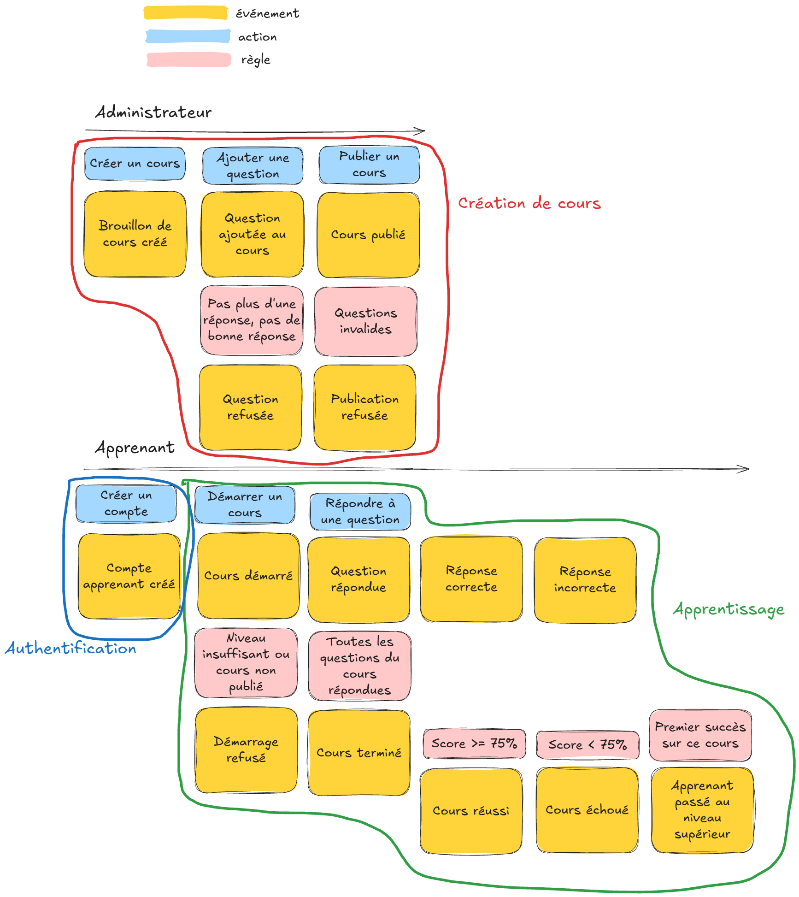
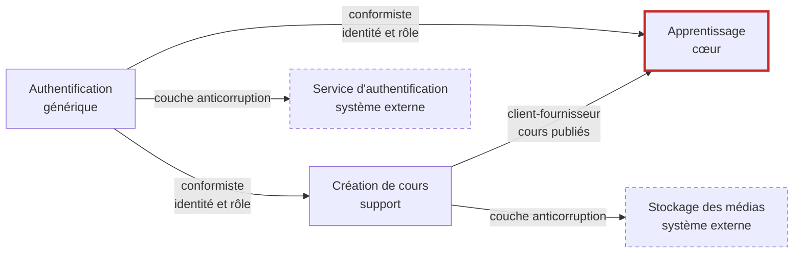

# Modélisation stratégique : application d'apprentissage du solfège et de l'oreille musicale

## 1. Event storming

Légende du mur : jaune = événement · bleu = commande · rose = règle · violet = système externe · rouge = point chaud.

| Acteur            | Commande ou règle                                     | Événement(s)                                                                                            | Contexte          |
|-------------------|-------------------------------------------------------|---------------------------------------------------------------------------------------------------------|-------------------|
| Administrateur    | Créer un cours                                        | Brouillon de cours créé                                                                                 | Création de cours |
| Administrateur    | Ajouter une question                                  | Question ajoutée au cours · Question refusée *(moins de 2 options, ou aucune bonne réponse)*            | Création de cours |
| Administrateur    | Publier un cours                                      | Cours publié · Publication refusée *(aucune question, ordre ou niveau requis manquant, ou déjà publié)* | Création de cours |
| Apprenant         | Créer un compte                                       | Compte apprenant créé                                                                                   | Authentification  |
| Apprenant         | Démarrer un cours                                     | Cours démarré · Démarrage refusé *(niveau insuffisant, ou cours non publié)*                            | Apprentissage     |
| Apprenant         | Répondre à une question                               | Question répondue · Réponse correcte · Réponse incorrecte                                               | Apprentissage     |
| Règle automatique | Dès que toutes les questions sont répondues           | Cours terminé                                                                                           | Apprentissage     |
| Règle automatique | Dès que le cours est terminé : score ≥ 75 % ou < 75 % | Cours réussi · Cours échoué                                                                             | Apprentissage     |
| Règle automatique | Dès qu'un cours est réussi pour la première fois      | Apprenant passé au niveau supérieur                                                                     | Apprentissage     |

**Systèmes externes** : service d'authentification · stockage des médias (images, partitions, MIDI).

**Points chauds** (questions ouvertes) :
- Après un échec, l'apprenant peut-il retenter tout de suite ?
- Peut-on modifier un cours déjà publié ?
- Une tentative abandonnée en cours de route : on la garde ou on l'efface ?

## 2. Glossaire

/!\ = mot qui change de sens selon le contexte.

| Mot                     | Contexte                                 | Définition |
|-------------------------|------------------------------------------|----|
| **Cours** /!\           | Création, Apprentissage                  | *Création* : un contenu que l'administrateur compose, brouillon puis publié, avec ses questions et leurs bonnes réponses. *Apprentissage* : une leçon publiée que l'apprenant démarre, suit, puis réussit ou échoue.
| **Apprenant** /!\       | Authentification, Apprentissage          | *Authentification* : un compte avec un identifiant et le rôle « apprenant ». *Apprentissage* : une personne qui progresse, avec un niveau et des cours réussis.
| **Administrateur**      | Création, Authentification               | La personne qui crée et publie les cours. Seule à pouvoir publier.
| **Brouillon**           | Création                                 | Un cours pas encore publié, invisible pour les apprenants.
| **Publication**         | Création                                 | Le passage d'un cours de brouillon à publié, qui le rend accessible aux apprenants.
| **Question**            | Création, Apprentissage                  | Un énoncé (texte, image, partition ou MIDI) accompagné d'options. Côté apprenant, elle est présentée sans ses bonnes réponses.
| **Option**              | Création                                 | Une réponse proposée pour une question. Une question en a au moins 2.
| **Bonne réponse**       | Création, Apprentissage                  | Une option attendue. Une question en a au moins une. Elle ne quitte jamais le serveur.
| **Réponse**             | Apprentissage                            | L'option choisie par l'apprenant pour une question, correcte ou incorrecte. À ne pas confondre avec « bonne réponse ».
| **Ordre des questions** | Création                                 | Fixe ou aléatoire, choisi par l'administrateur pour chaque cours.
| **Niveau requis**       | Création (fixé), Apprentissage (vérifié) | Le niveau minimum pour démarrer un cours, fixé par l'administrateur.
| **Niveau**              | Apprentissage                            | Le nombre de cours qu'un apprenant a réussis au moins une fois.
| **Seuil de réussite**   | Apprentissage                            | 75 % de réponses correctes, le même pour tous les cours.
| **Tentative**           | Apprentissage                            | Un passage d'un apprenant sur un cours, de son démarrage à sa fin. Elle garde ses réponses.
| **Progression**         | Apprentissage                            | Les cours réussis par un apprenant et son niveau, conservés ensemble.

## 3. Sous-domaines

| Partie              | Type      | Pourquoi |
|---------------------|-----------|---|
| Apprentissage       | **Cœur**  | C'est pour cela qu'on vient : accès par niveau, correction question par question, seuil de réussite, pas de régression. Ce sont les règles qui évolueront le plus (révisions, séries…). 
| Création de cours   | Support   | Nécessaire au cœur, mais ses règles sont des validations simples : options, bonne réponse, conditions de publication.
| Authentification    | Générique | Tout le monde s'authentifie de la même façon : on l'achète.
| Stockage des médias | Générique | Stocker et servir des fichiers est un problème standard : service externe.

## 4. Context map

*Flèche : de l'amont vers l'aval.*

- **Création → Apprentissage (client-fournisseur)** : la Création fournit les cours publiés. Si leur forme change, c'est l'Apprentissage qui s'adapte, jamais l'inverse.
- **Authentification → Création et Apprentissage (conformiste)** : les deux contextes prennent l'identité et le rôle (administrateur ou apprenant) tels quels, sans négocier.
- **Authentification → Service d'authentification (couche anticorruption)** : un adapter traduit le fournisseur dans nos mots. Aucun terme du fournisseur ne sort de cet adapter.
- **Création → Stockage des médias (couche anticorruption)** : même principe. Le cours ne connaît que des références vers ses médias.

## 5. DDD ou pas

| Contexte            | Choix           | Pourquoi                                                                                                                                       |
|---------------------|-----------------|------------------------------------------------------------------------------------------------------------------------------------------------|
| Apprentissage       | **DDD complet** | C'est le cœur. Règles riches, modélisées avec soin, testées sans base de données (hexagone).                                                   |
| Création de cours   | **Simple**      | Un modèle simple suffit. Les quelques règles (question valide, conditions de publication) sont testées, sans agrégats ni événements complexes. |
| Authentification    | **Pas de DDD**  | Adapter.                                                                                                                                       |
| Stockage des médias | **Pas de DDD**  | Service externe, plus un adapter.                                                                                                              |

## 6. Le contexte codé en séance 3 : Apprentissage

C'est le cœur, celui qui porte les règles qui comptent. Les cas où une action est refusée :

- **Démarrer un cours** : cours inexistant · cours non publié · niveau insuffisant.
- **Répondre à une question** : aucune tentative en cours sur ce cours · question absente du cours · question déjà répondue · option inexistante.
- **Fin du cours** (règle automatique) : déclenchée seulement quand toutes les questions sont répondues. Un score sous le seuil n'est pas un refus mais un résultat (cours échoué). Un cours déjà réussi le reste.
